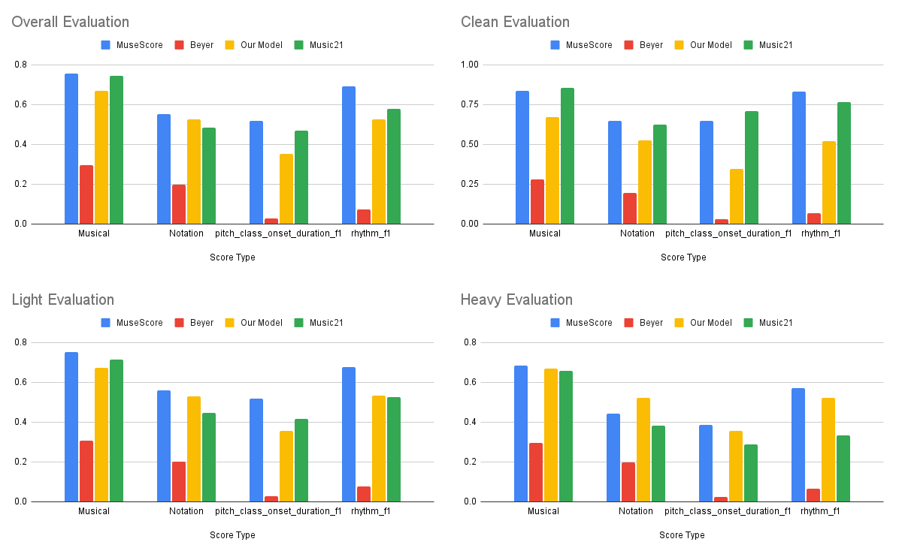

# MIDI to Score with Pretrained MusicXML Decoder

**Noise-Robust MIDI-to-Score Transcription via Asymmetric Transformers and Pretrained MusicXML Decoders**

**Authors**: Yi-Chieh Chiu · Bo Gao · Hao Jiang · Siyuan Bao · Ioannis Tsotras

[](./CSCI544_Final_Report_Group13.pdf)
[](https://github.com/ChiuYeeJay/CSCI544-Project-MIDI2Score/releases)

[English](./README.md) | [繁體中文](./README_zh-TW.md) | [简体中文](./README_zh-CN.md)

---

## Overview

> **Origin**: Final research project (Group 13) for **CSCI 544: Applied Natural Language Processing** at the **University of Southern California (USC)**. [Read the Final Report (PDF)](./CSCI544_Final_Report_Group13.pdf).

This project builds a Transformer-based automatic music transcription system that translates **human-played, timing-imperfect MIDI signals** directly into **structurally coherent, human-readable MusicXML sheet music**.

### Motivation

In modern Digital Audio Workstation (DAW) workflows, composers routinely record ideas via MIDI keyboards and render audio directly. However, whenever a piece needs to be performed live or recorded by human musicians, that MIDI data must be converted into readable sheet music—a tedious, repetitive, and time-consuming chore. Existing tools fall short of solving this workflow bottleneck:

- **Unreliable Rule-Based Software**: Even when recorded against a DAW click track, human-played MIDI contains subtle timing and duration deviations that cause traditional notation software to produce fragmented, unreadable rhythms. Moreover, MIDI only records raw note triggers (`note-on` / `note-off`) without musical semantics such as voice separation, hand/staff assignment, or beaming—often forcing composers to spend hours fixing scores manually or rewriting them from scratch.
- **Gaps in Existing ML Approaches**: Automatic Music Transcription (AMT) and free-performance MIDI-to-Score models target unaligned audio or rubato performances, ignoring the reliable tempo and beat grid already present in DAWs. Conversely, neural engraving models assume perfectly quantized MIDI inputs, leaving the practical needs of DAW users unaddressed.

### Our Approach

Targeting this realistic scenario—where the underlying beat grid is reliable, yet individual notes carry human timing imperfections—we formulate the task as a **noise-robust sequence-to-sequence (Seq2Seq) translation problem**:

- **Realistic Performance Noise Simulation**: We convert scores from the large-scale public **PDMX** dataset into paired MIDI files and inject synthetic tempo drift, onset jitter, and duration fluctuations to mimic human keyboard input in a DAW.
- **Asymmetric Transformer with Decoder Pre-training**: We pair an **8-layer CPWord encoder** with a **4-layer LMX decoder**—allocating depth to input denoising while keeping autoregressive decoding fast. Inspired by large language models, we first **pre-train the decoder** on standalone MusicXML data to internalize valid score syntax before Seq2Seq fine-tuning.
- **Easy-to-Hard Curriculum Learning**: Training starts on clean, quantized pairs so the model rapidly grounds cross-modal token semantics, then progressively ramps up noise intensity to build robustness against timing errors.

---

## Architecture & Methodology

### System Pipeline

```text
[Stage 1: MusicXML Decoder Pre-training]
PDMX Score Corpus ──► LMX Linearization + BPE ──► Bar-aware Chunking ──► 4-Layer Decoder Pre-training
                                                                                      │
                                                                         (Load Pretrained Weights)
[Stage 2: Noise-Robust Seq2Seq Fine-tuning & Inference]                               ▼
Noisy Played MIDI ──► CPWord Compound Tokens ──► 8-Layer Encoder (Denoising) ──► 4-Layer Decoder ──► LMX Tokens ──► MusicXML Score
```

### 1. Tokenization

- **Input (MIDI — CPWord)**: Using a Compound Word representation, multiple musical attributes at each time step—such as pitch, duration, sub-beat position, tempo, and time signature—are bundled into a single compound token and projected into the model space via a custom multi-attribute embedding layer.
- **Output (MusicXML — LMX + BPE)**: Hierarchical MusicXML trees are linearized into 1D token sequences (Linearized MusicXML, LMX) and compressed with Byte-Pair Encoding (BPE), paired with BPE Dropout during training to improve decoder resilience against local perturbations.

### 2. Dataset Construction & Noise Simulation

- **Bar-Aligned Truncation & Leak-Free Splitting**: Paired MIDI-MusicXML data generated from PDMX is partitioned into train, validation, and test splits at the song level to prevent data leakage. Long pieces are truncated synchronously **strictly at matching measure boundaries** across both modalities, preserving valid score grammar and exact cross-modal alignment.
- **Synthetic Human Timing Imperfections**: Clean MIDI sequences are perturbed with **onset jitter**, **tempo drift**, and **duration fluctuations** across three intensity tiers—`Clean`, `Light`, and `Heavy`—reflecting real-world DAW keyboard recording characteristics.

### 3. Model Design & Two-Stage Training

- **Asymmetric Transformer (Deep Encoder, Shallow Decoder)**: Configured with an **8-layer encoder and 4-layer decoder**, allowing the deeper encoder to focus on rhythmic denoising and alignment while the shallower decoder generates valid notation with lower autoregressive latency. The architecture incorporates modern Transformer components including RoPE, Pre-Norm RMSNorm, and FlashAttention.
- **Decoder Pre-training & Discriminative Fine-tuning**: In Stage 1, the decoder is pre-trained on bar-aware MusicXML chunks (accelerated via length bucketing and dynamic token-budget batching). In Stage 2, the encoder is attached for end-to-end fine-tuning using a reduced learning rate on the decoder to prevent catastrophic forgetting of score syntax.
- **Curriculum Learning & Inference Optimization**: Fine-tuning begins exclusively on clean MIDI-score pairs and gradually shifts toward heavier noise distributions across epochs. At inference time, **KV Caching** accelerates generation while a **Repetition Penalty** suppresses looping hallucinations.

### Repository Structure

```text
.
├── midi2score/              # Core Seq2Seq architecture, KV-cached generation, and training loop
├── decoder_pretraining/     # MusicXML decoder pre-training submodule (bar-aware chunking, dynamic batching)
├── data_preprocessing/      # PDMX filtering, part extraction, and leak-free dataset splitting
├── tokenizer/               # CPWord configuration, LMX BPE training, and MIDI noise augmentation
├── hf_dataset/              # Dataset builders and synchronous bar-aware truncation scripts
├── configs/                 # YAML configurations for ablations and final models
├── run_seq2seq.py           # Entry point for Seq2Seq training
├── transcribe.py            # Transcribe one MIDI file to MusicXML
├── convert.py               # Batch conversion script for external baselines (music21 / MuseScore)
└── evaluation.py            # Standardized MusicXML evaluation suite
```

---

## Quick Start

> Note: Below is a streamlined guide for environment setup, inference, and training. For full instructions on building datasets from raw PDMX files, training tokenizers, and reproducing all paper experiments, see **[REPRODUCTION.md](./REPRODUCTION.md)**.

### 1. Installation

- **Python**: `>= 3.11`
- **Hardware**: NVIDIA GPU (CUDA, recommended for training), Apple Silicon (MPS), or CPU

Install dependencies via `uv` (recommended) or `pip`:

```bash
# Clone the repository (including the decoder pre-training submodule)
git clone --recurse-submodules https://github.com/ChiuYeeJay/CSCI544-Project-MIDI2Score.git
cd CSCI544-Project-MIDI2Score

# Option A: Using uv
uv sync
source .venv/bin/activate

# Option B: Using pip
pip install -r requirements.txt
```

### 2. Weights, Tokenizer & Datasets

- **Model Weights & Tokenizer**: Download the trained checkpoints (pretrained decoder and best Seq2Seq `.pt` weights) and the BPE tokenizer (`tokenizer.json`) from **[GitHub Releases](https://github.com/ChiuYeeJay/CSCI544-Project-MIDI2Score/releases)**.
- **Dataset Preparation**: Training and evaluation datasets can be generated from the public **[PDMX Dataset (Zenodo)](https://zenodo.org/records/15571083)** using the scripts under `data_preprocessing/` and `hf_dataset/` (see [REPRODUCTION.md](./REPRODUCTION.md) for step-by-step commands). Make sure the paths in your YAML config (e.g., `configs/experiments/seq2seq_fullft_32.yaml`) point to your local dataset, tokenizer, and checkpoint files.

### 3. Inference & Score Generation

To transcribe a single MIDI file, run `transcribe.py` with the checkpoint, the YAML config for that checkpoint, and the LMX BPE tokenizer:

```bash
python3 transcribe.py \
  --midi input.mid \
  --checkpoint checkpoints/<model_checkpoint>.pt \
  --tokenizer tokenizer/tokenizer.json \
  --config configs/experiments/seq2seq_fullft_32.yaml \
  --output output.musicxml
```

`--config` has to match the checkpoint architecture, because the `.pt` file stores weights only. `--tokenizer` is the LMX BPE file (`tokenizer.json`); the script encodes MIDI with the CPWord tokenizer in this repository. Omit `--output` to write `<midi_stem>.musicxml` next to the input. Sequences longer than `max_source_length` (1024 in the example config, including BOS and EOS) are cut from the front, and the script prints a warning. `--save-lmx` also writes the intermediate LMX. The device defaults to `auto`: CUDA, then Apple Silicon MPS, then CPU.

Once an evaluation dataset is ready, run `midi2score/pred_seq2seq.py` to transcribe that set into `.musicxml` files and compute evaluation metrics:

```bash
python3 midi2score/pred_seq2seq.py \
  --config configs/experiments/seq2seq_fullft_32.yaml \
  --ckpt checkpoints/<model_checkpoint>.pt \
  --eval-root dataset/eval_dataset \
  --out-dir outputs/demo_eval \
  --repetition-penalty 1.2 \
  --batch-size 4 \
  --max-samples 10 \
  --onset-tol 0.25 \
  --duration-tol 0.25
```

Generated LMX sequences, `.musicxml` scores (ready to open in MuseScore or any notation editor), and evaluation reports will be saved to `outputs/demo_eval/`.

### 4. Training (Optional)

After verifying the file paths in your YAML config, launch Seq2Seq training with:

```bash
python3 run_seq2seq.py --config configs/experiments/seq2seq_fullft_32.yaml
```

---

## Evaluation & Results

### Key Ablation Findings

Controlled ablation studies (detailed in Section 5 of our report) validated each core design choice:

- **Decoder Pre-training Boosts Downstream Accuracy**: Initializing with a MusicXML-pretrained decoder consistently outperforms training Seq2Seq from scratch, confirming that structural score priors ease cross-modal learning.
- **Curriculum Learning Stabilizes Convergence**: Gradually introducing timing noise eliminates early training instability and converges to a lower validation loss than training on mixed noise from the start.
- **Full Fine-Tuning Outperforms LoRA**: Under our deep-encoder / shallow-decoder layout, full fine-tuning incurs minimal extra memory or runtime overhead compared to LoRA while giving the decoder greater flexibility to adapt to denoised encoder features.
- **Asymmetric Design (8-4 vs. 6-6) Trades Minimal Accuracy for Faster Decoding**: Compared to a symmetric 6-6 baseline, our 8-4 architecture sacrifices only ~1% token accuracy while cutting decoder layers by a third for faster autoregressive inference.

### Baseline Comparison

We benchmarked our final model against professional notation software (**MuseScore**), symbolic music toolkit (**music21**), and a recent neural MIDI-to-score baseline (**Beyer et al., 2024**) across `Clean`, `Light`, and `Heavy` noise subsets. Metrics evaluate overall musical content (`Musical`), structural readability (`Notation`), fine-grained note alignment (`pitch_class_onset_duration_f1`), and rhythmic consistency (`rhythm_f1`):



#### Key Takeaways

- **Strong Noise Robustness**: Rule-based tools (`MuseScore`, `music21`) excel on perfectly quantized `Clean` MIDI, but degrade sharply as human timing errors increase. In contrast, **our model maintains highly consistent performance across all noise levels**.
- **Superior Notation Structure Under Heavy Noise**: On the **Heavy** noise subset—closest to unquantized keyboard input—our model **surpasses both MuseScore and music21 on the `Notation` metric** and outperforms the Beyer neural baseline by a wide margin across every setting, demonstrating the effectiveness of combining pretrained MusicXML decoders with curriculum denoising.

---

## Contributions

- **Yi-Chieh Chiu** (Project Lead): Project direction and experimental design; end-to-end data preprocessing, tokenization, and bar-aware truncation pipelines; advanced Seq2Seq training features (curriculum learning, length bucketing, full fine-tuning) and core experiments.
- **Bo Gao**: MusicXML decoder pre-training pipeline ([`decoder_pretraining`](https://github.com/daniellaah/MIDI2Score)) and pre-training ablation studies.
- **Hao Jiang**: Core Seq2Seq training framework, custom CPWord embedding layer, and autoregressive inference pipeline.
- **Siyuan Bao**: `partitura`-based MusicXML evaluation framework, composite metric design, and result analysis.
- **Ioannis Tsotras**: Automated conversion pipeline and benchmarking for external baselines (`music21`, `MuseScore`).

---

## Citation

If you find this repository, methodology, or report useful in your research or projects, please consider citing our work:

```bibtex
@misc{chiu2026midi2score,
  title        = {MIDI to Score with Pretrained MusicXML Decoder},
  author       = {Chiu, Yi-Chieh and Gao, Bo and Jiang, Hao and Bao, Siyuan and Tsotras, Ioannis},
  year         = {2026},
  howpublished = {\url{https://github.com/ChiuYeeJay/CSCI544-Project-MIDI2Score}},
  note         = {CSCI 544 (Applied Natural Language Processing) Course Project Report, University of Southern California}
}
```
