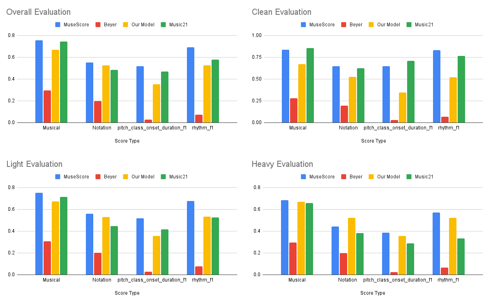

# MIDI to Score with Pretrained MusicXML Decoder

**基于预训练 MusicXML 解码器与非对称 Transformer 的抗噪声 MIDI 自动转谱系统**

**团队成员**：Yi-Chieh Chiu · Bo Gao · Hao Jiang · Siyuan Bao · Ioannis Tsotras

[](./CSCI544_Final_Report_Group13.pdf)
[](https://github.com/ChiuYeeJay/CSCI544-Project-MIDI2Score/releases)

[English](./README.md) | [繁體中文](./README_zh-TW.md) | [简体中文](./README_zh-CN.md)

---

## 项目简介

> **项目来源**：南加州大学（University of Southern California, USC）研究生课程 **CSCI 544: Applied Natural Language Processing** 期末研究项目（Group 13）。[点此阅读期末报告 PDF](./CSCI544_Final_Report_Group13.pdf)。

本项目开发了一个基于 Transformer 的自动转谱系统，能将**由人手弹奏录入、带有时间误差的 MIDI 信号**，直接转换成排版合理、易于人类阅读的 **MusicXML 五线谱**。

### 动机

在数字音乐工作站（DAW）的编曲流程中，音乐家常通过 MIDI 键盘录制作品并直接输出音频；但当乐曲需要交由真人乐手现场演出或进录音室录音时，就必须将 MIDI 转译成五线谱——这是一项繁重、重复性高且耗时的苦差事。然而现有工具难以满足这项需求：

- **传统打谱软件质量难以信赖**：键盘录入的 MIDI 虽大致对齐节拍器速度，个别音符的触发时间点与时长仍有微小偏差，直接转换常导致节奏破碎难读；此外，MIDI 仅记录「音符在何时触发与结束」，缺乏分声部、左右手配置、符杠分组等乐理语义，转换后往往仍需耗费大量时间人工重修。
- **既有机器学习研究的落差**：自动音乐转谱（AMT）或自由演奏转谱（Performance MIDI-to-Score）多针对无节拍信息的音频／演奏设计，忽略了 DAW 内建的可靠速度与拍点信息；而专注于乐谱排版的模型又假设输入 MIDI 节拍已完全精准量化，皆未能直接解决 DAW 使用者的痛点。

### 解决方法

针对上述「拍点大致可信、但含演奏误差」的场景，我们将任务定义为**抗噪声序列对序列（Seq2Seq）翻译问题**：

- **合成拟真演奏误差数据**：从大型公开乐谱数据集 **PDMX** 转出配对 MIDI，人工注入速度偏移、触键时间与音长误差，模拟人类在 DAW 中输入 MIDI 的真实特性。
- **非对称 Transformer 与解码器预训练**：采用 **8 层 CPWord 编码器 + 4 层 LMX 解码器**（深编码去噪、浅解码兼顾推理效率）。受大型语言模型启发，我们先在纯乐谱数据上**预训练 Decoder** 以掌握 MusicXML 语法结构，再接上 Encoder 进行微调。
- **由简入繁的课程学习（Curriculum Learning）**：训练初期先以无噪声数据让模型建立基础转谱对应，再逐步提高噪声强度，强化其处理不精确 MIDI 的能力。

---

## 技术架构与方法解析

### 系统流程概览

```text
【阶段一：MusicXML 解码器预训练】
PDMX 乐谱库 ──► LMX 线性化 + BPE ──► 小节感知切分 (Bar-aware Chunking) ──► 4-Layer Decoder 预训练
                                                                                    │
                                                                            (载入预训练权重)
【阶段二：抗噪声 Seq2Seq 课程微调与推理】                                              ▼
含噪声演奏 MIDI ──► CPWord 复合编码 ──► 8-Layer Encoder (去噪声/特征抽取) ──► 4-Layer Decoder ──► LMX Token ──► 标准 MusicXML 乐谱
```

### 1. Tokenization

- **输入端（MIDI — CPWord）**：采用 Compound Word 表示法，将每个时间点的音高、时长、拍内位置、速度与拍号等多种音乐属性打包为复合 Token，并通过定制化的多属性嵌入层（Embedding Layer）投影为模型输入向量。
- **输出端（MusicXML — LMX + BPE）**：将层级式的 MusicXML 树状结构线性化为一维序列（LMX），再通过 BPE 压缩序列长度，并结合 BPE Dropout 提升解码器对局部扰动的容错力。

### 2. 数据构建与演奏噪声模拟

- **小节对齐截断与防泄漏切分**：将公开的 PDMX 乐谱转为配对 MIDI，以曲目为单位切分训练、验证与测试集以避免数据泄漏；针对过长乐曲，强制仅在**对应的相同小节线**上同步截断 MIDI 与乐谱序列，确保语法结构完整且两端严格对齐。
- **拟真演奏误差注入**：在干净 MIDI 中随机加入**触键时间误差**、**整体速度漂移**与**音符时长波动**，合成出无噪声（Clean）、轻度（Light）与重度（Heavy）三种强度的训练样本，模拟音乐家在 DAW 键盘录入时的真实特性。

### 3. 模型架构与两阶段训练

- **非对称 Transformer（Deep Encoder, Shallow Decoder）**：配置 **8 层 Encoder + 4 层 Decoder**——由较深的编码器专注处理输入端的去噪声与节奏对齐，较浅的解码器负责乐谱语法生成并有效降低自回归推理成本；模型内部整合 RoPE、RMSNorm 与 FlashAttention 等现代 Transformer 设计。
- **解码器预训练与差异化微调**：第一阶段先以纯乐谱数据对 Decoder 进行小节感知的语言模型预训练（搭配长度分桶与动态批次提升训练效率）；第二阶段接上 Encoder 进行全参数微调，并调降 Decoder 学习率以保留预训练习得的语法先验。
- **课程学习与推理优化**：微调初期仅使用无噪声数据让模型快速建立跨模态对应，再随训练阶段逐步提高噪声比例；推理阶段则实现 **KV Cache** 加速解码，并加入 **Repetition Penalty** 抑制重复生成幻觉。

### 项目目录结构

```text
.
├── midi2score/              # 核心模型与训练/推理框架 (Encoder-Decoder, KV Cache, Trainer)
├── decoder_pretraining/     # MusicXML Decoder 预训练子模块 (Bar-aware chunking, Dynamic batching)
├── data_preprocessing/      # PDMX 数据集清理、声部拆解与防泄漏分割脚本
├── tokenizer/               # CPWord 设定、LMX BPE 训练与 MIDI 噪声增强模块
├── hf_dataset/              # 数据集构建与小节感知截断工具
├── configs/                 # 实验与最终模型之 YAML 设定档
├── run_seq2seq.py           # Seq2Seq 模型训练入口脚本
├── transcribe.py            # 将单个 MIDI 文件转成 MusicXML
├── convert.py               # 外部 Baseline (music21 / MuseScore) 批量转谱工具
└── evaluation.py            # 标准化乐谱评估指标系统
```

---

## 简易安装与使用指南

> 注：以下整理环境搭建与模型推理／训练的核心流程。完整的公开数据集处理步骤、Tokenizer 训练以及各项实验复现细节，请参阅 **[完整实验复现指南（REPRODUCTION.md）](./REPRODUCTION.md)**。

### 1. 环境需求与安装

- **Python 版本**：`>= 3.11`
- **支持硬件**：NVIDIA GPU（CUDA，建议用于训练）、Apple Silicon（MPS）或 CPU

使用 `uv`（推荐）或 `pip` 安装依赖包：

```bash
# 克隆仓库（含预训练子模块）
git clone --recurse-submodules https://github.com/ChiuYeeJay/CSCI544-Project-MIDI2Score.git
cd CSCI544-Project-MIDI2Score

# 方法 A：使用 uv 创建环境并同步依赖
uv sync
source .venv/bin/activate

# 方法 B：使用 pip 安装
pip install -r requirements.txt
```

### 2. 获取模型权重、Tokenizer 与数据集

- **模型权重与 Tokenizer**：请至 **[GitHub Releases](https://github.com/ChiuYeeJay/CSCI544-Project-MIDI2Score/releases)** 下载训练完成的模型权重（包含预训练 Decoder 与最佳 Seq2Seq 模型 `.pt` 文件）以及 BPE Tokenizer（`tokenizer.json`）。
- **数据集构建**：本项目的训练与评估数据集可由公开的 **[PDMX 数据集（Zenodo）](https://zenodo.org/records/15571083)** 通过 `data_preprocessing/` 与 `hf_dataset/` 内的脚本自动转换生成（详见 [完整实验复现指南](./REPRODUCTION.md)）。请确保对应 YAML 设定档（如 `configs/experiments/seq2seq_fullft_32.yaml`）中的数据集、Tokenizer 与预训练权重路径指向你的实际存放位置。

### 3. 执行模型推理与乐谱生成

若要转译单个 MIDI 文件，使用 `transcribe.py`，并提供模型权重、与该权重对应的 YAML 配置，以及 LMX BPE tokenizer：

```bash
python3 transcribe.py \
  --midi input.mid \
  --checkpoint checkpoints/<model_checkpoint>.pt \
  --tokenizer tokenizer/tokenizer.json \
  --config configs/experiments/seq2seq_fullft_32.yaml \
  --output output.musicxml
```

`.pt` 只存权重，所以 `--config` 必须与该 checkpoint 的架构一致。`--tokenizer` 是 LMX BPE 文件（`tokenizer.json`）；MIDI 会用本仓库内置的 CPWord tokenizer 编码。省略 `--output` 时，乐谱会写在 MIDI 旁边，扩展名为 `.musicxml`。长度超过 `max_source_length`（示例配置为 1024，含 BOS 与 EOS）的曲子只保留前段，脚本会打印警告。加上 `--save-lmx` 会一并写出中间的 LMX。设备默认为 `auto`：依次使用 CUDA、Apple Silicon MPS、CPU。

备妥评估数据集后，可使用 `midi2score/pred_seq2seq.py` 将测试集中的 MIDI 转译为标准 `.musicxml` 乐谱并自动执行评估：

```bash
python3 midi2score/pred_seq2seq.py \
  --config configs/experiments/seq2seq_fullft_32.yaml \
  --ckpt checkpoints/<model_checkpoint>.pt \
  --eval-root dataset/eval_dataset \
  --out-dir outputs/demo_eval \
  --repetition-penalty 1.2 \
  --batch-size 4 \
  --max-samples 10 \
  --onset-tol 0.25 \
  --duration-tol 0.25
```

执行完成后，`outputs/demo_eval/` 目录中将产出生成的 LMX 序列、转换后的 `.musicxml` 乐谱文件（可直接以 MuseScore 等打谱软件打开查看）以及各项指标统计报告。

### 4. 启动模型训练（可选）

确认 YAML 设定档内的数据集、Tokenizer 与预训练 Decoder 路径无误后，即可启动 Seq2Seq 训练：

```bash
python3 run_seq2seq.py --config configs/experiments/seq2seq_fullft_32.yaml
```

---

## 实验与评估结果

### 消融实验重点发现

通过控制变量实验，我们验证了系统中各项核心设计的效益（详见期末报告第 5 节）：

- **预训练 Decoder 有效提升表现**：相较于从零开始端到端训练，预先学习乐谱语法的 Decoder 能显著降低跨模态学习负担并提升最终准确率。
- **课程学习加速并稳定收敛**：由无噪声逐步过渡至高噪声的训练策略，成功消除了训练初期的剧烈震荡，收敛至更佳的验证表现。
- **全参数微调优于 LoRA**：在深编码、浅解码架构下，全参数微调与 LoRA 的训练成本相近，但搭配差异化学习率的全参数微调能让 Decoder 更充分适应去噪声后的特征。
- **非对称架构（8-4 vs. 6-6）具推理效率优势**：8-4 架构与传统 6-6 对称架构的准确率差距仅约 1%，却能减少三分之一的 Decoder 层数以加速自回归生成。

### 与外部 Baseline 之比较

我们将最终模型与专业打谱软件 **MuseScore**、音乐分析工具 **music21** 以及近期端到端神经网络模型 **Beyer et al. (2024)** 在不同噪声强度（Clean / Light / Heavy）下进行评估。评估涵盖综合音乐内容正确度（`Musical`）、谱面结构与可读性（`Notation`）、音符层级对齐（`pitch_class_onset_duration_f1`）以及节奏一致性（`rhythm_f1`）：



#### 结果分析

- **高度的抗噪声稳健性**：传统规则式工具（`MuseScore`、`music21`）虽在完全精准的 Clean MIDI 上表现优异，但随着演奏误差增加，各项指标皆明显下滑；相对地，**本项目模型在所有噪声强度下均维持稳定一致的表现**。
- **重度噪声下的谱面结构优势**：在最贴近真实键盘录入误差的 **Heavy** 测试集上，本模型的 **Notation（谱面结构与可读性）得分超越了 MuseScore 与 music21**，并在所有情境下大幅领先同为神经网络方法的 Beyer 模型，展现了预训练解码器与课程学习在抗噪声转谱上的潜力。

---

## 贡献（Contributions）

- **Yi-Chieh Chiu**（Project Lead）：项目主导与实验规划、数据预处理与 Tokenization 管线、Seq2Seq 进阶训练机制与核心实验
- **Bo Gao**：MusicXML 解码器预训练管线（[`decoder_pretraining`](https://github.com/daniellaah/MIDI2Score)）与预训练消融实验
- **Hao Jiang**：Seq2Seq 基础训练框架、CPWord 嵌入层与自回归推理实现
- **Siyuan Bao**：基于 `partitura` 之乐谱评估指标系统与结果分析
- **Ioannis Tsotras**：外部 Baseline（`music21`、`MuseScore`）转谱流程与基准测试

---

## 引用（Citation）

若本项目的代码、方法或实验结果对您的研究与开发有所帮助，欢迎通过以下 BibTeX 引用我们的期末报告与仓库：

```bibtex
@misc{chiu2026midi2score,
  title        = {MIDI to Score with Pretrained MusicXML Decoder},
  author       = {Chiu, Yi-Chieh and Gao, Bo and Jiang, Hao and Bao, Siyuan and Tsotras, Ioannis},
  year         = {2026},
  howpublished = {\url{https://github.com/ChiuYeeJay/CSCI544-Project-MIDI2Score}},
  note         = {CSCI 544 (Applied Natural Language Processing) Course Project Report, University of Southern California}
}
```
