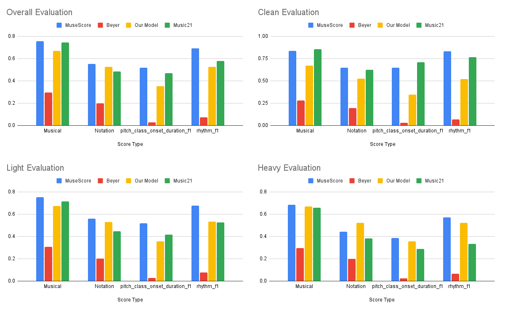

# MIDI to Score with Pretrained MusicXML Decoder

**基於預訓練 MusicXML 解碼器與非對稱 Transformer 的抗雜訊 MIDI 自動轉譜系統**

**團隊成員**：Yi-Chieh Chiu · Bo Gao · Hao Jiang · Siyuan Bao · Ioannis Tsotras

[](./CSCI544_Final_Report_Group13.pdf)
[](https://github.com/ChiuYeeJay/CSCI544-Project-MIDI2Score/releases)
[](https://chiuyeejay.github.io/CSCI544-M2S-Web-Demo/)

[English](./README.md) | [繁體中文](./README_zh-TW.md) | [简体中文](./README_zh-CN.md)

---

## 專案簡介

> **專案來源**：南加州大學（University of Southern California, USC）研究所課程 **CSCI 544: Applied Natural Language Processing** 期末研究專案（Group 13）。[點此閱讀期末報告 PDF](./CSCI544_Final_Report_Group13.pdf)。

本專案開發了一個基於 Transformer 的自動轉譜系統，能將**由人手彈奏錄入、帶有時間誤差的 MIDI 訊號**，直接轉換成排版合理、易於人類閱讀的 **MusicXML 五線譜**。

### 動機

在數位音樂工作站（DAW）的編曲流程中，音樂家常透過 MIDI 鍵盤錄製作品並直接輸出音訊；但當樂曲需要交由真人樂手現場演出或進錄音室錄音時，就必須將 MIDI 轉譯成五線譜——這是一項繁重、重複性高且耗時的苦差事。然而現有工具難以滿足這項需求：

- **傳統打譜軟體品質難以信賴**：鍵盤錄入的 MIDI 雖大致對齊節拍器速度，個別音符的觸發時間點與時長仍有微小偏差，直接轉換常導致節奏破碎難讀；此外，MIDI 僅記錄「音符在何時觸發與結束」，缺乏分聲部、左右手配置、符槓分組等樂理語意，轉換後往往仍需耗費大量時間人工重修。
- **既有機器學習研究的落差**：自動音樂轉譜（AMT）或自由演奏轉譜（Performance MIDI-to-Score）多針對無節拍資訊的音訊／演奏設計，忽略了 DAW 內建的可靠速度與拍點資訊；而專注於樂譜排版的模型又假設輸入 MIDI 節拍已完全精準量化，皆未能直接解決 DAW 使用者的痛點。

### 解決方法

針對上述「拍點大致可信、但含演奏誤差」的場景，我們將任務定義為**抗雜訊序列對序列（Seq2Seq）翻譯問題**：

- **合成擬真演奏誤差資料**：從大型公開樂譜資料集 **PDMX** 轉出配對 MIDI，人工注入速度偏移、觸鍵時間與音長誤差，模擬人類在 DAW 中輸入 MIDI 的真實特性。
- **非對稱 Transformer 與解碼器預訓練**：採用 **8 層 CPWord 編碼器 + 4 層 LMX 解碼器**（深編碼去噪、淺解碼兼顧推論效率）。受大型語言模型啟發，我們先在純樂譜資料上**預訓練 Decoder** 以掌握 MusicXML 語法結構，再接上 Encoder 進行微調。
- **由簡入繁的課程學習（Curriculum Learning）**：訓練初期先以無雜訊資料讓模型建立基礎轉譜對應，再逐步提高雜訊強度，強化其處理不精確 MIDI 的能力。

---

## 技術架構與方法解析


### 系統流程概覽

```text
【階段一：MusicXML 解碼器預訓練】
PDMX 樂譜庫 ──► LMX 線性化 + BPE ──► 小節感知切分 (Bar-aware Chunking) ──► 4-Layer Decoder 預訓練
                                                                                    │
                                                                            (載入預訓練權重)
【階段二：抗雜訊 Seq2Seq 課程微調與推論】                                              ▼
含雜訊演奏 MIDI ──► CPWord 複合編碼 ──► 8-Layer Encoder (去雜訊/特徵抽取) ──► 4-Layer Decoder ──► LMX Token ──► 標準 MusicXML 樂譜
```

### 1. Tokenization

- **輸入端（MIDI — CPWord）**：採用 Compound Word 表示法，將每個時間點的音高、時長、拍內位置、速度與拍號等多種音樂屬性打包為複合 Token，並透過客製化的多屬性嵌入層（Embedding Layer）投影為模型輸入向量。
- **輸出端（MusicXML — LMX + BPE）**：將階層式的 MusicXML 樹狀結構線性化為一維序列（LMX），再透過 BPE 壓縮序列長度，並結合 BPE Dropout 提升解碼器對局部擾動的容錯力。

### 2. 資料建置與演奏雜訊模擬

- **小節對齊截斷與防洩漏切分**：將公開的 PDMX 樂譜轉為配對 MIDI，以曲目為單位切分訓練、驗證與測試集以避免資料洩漏；針對過長樂曲，強制僅在**對應的相同小節線**上同步截斷 MIDI 與樂譜序列，確保語法結構完整且兩端嚴格對齊。
- **擬真演奏誤差注入**：在乾淨 MIDI 中隨機加入**觸鍵時間誤差**、**整體速度漂移**與**音符時長波動**，合成出無雜訊（Clean）、輕度（Light）與重度（Heavy）三種強度的訓練樣本，模擬音樂家在 DAW 鍵盤錄入時的真實特性。

### 3. 模型架構與兩階段訓練

- **非對稱 Transformer（Deep Encoder, Shallow Decoder）**：配置 **8 層 Encoder + 4 層 Decoder**——由較深的編碼器專注處理輸入端的去雜訊與節奏對齊，較淺的解碼器負責樂譜語法生成並有效降低自迴歸推論成本；模型內部整合 RoPE、RMSNorm 與 FlashAttention 等現代 Transformer 設計。
- **解碼器預訓練與差異化微調**：第一階段先以純樂譜資料對 Decoder 進行小節感知的語言模型預訓練（搭配長度分桶與動態批次提升訓練效率）；第二階段接上 Encoder 進行全參數微調，並調降 Decoder 學習率以保留預訓練習得的語法先驗。
- **課程學習與推論最佳化**：微調初期僅使用無雜訊資料讓模型快速建立跨模態對應，再隨訓練階段逐步提高雜訊比例；推論階段則實作 **KV Cache** 加速解碼，並加入 **Repetition Penalty** 抑制重複生成幻覺。

### 專案目錄結構

```text
.
├── midi2score/              # 核心模型與訓練/推論框架 (Encoder-Decoder, KV Cache, Trainer)
├── decoder_pretraining/     # MusicXML Decoder 預訓練子模組 (Bar-aware chunking, Dynamic batching)
├── data_preprocessing/      # PDMX 資料集清理、聲部拆解與防洩漏分割腳本
├── tokenizer/               # CPWord 設定、LMX BPE 訓練與 MIDI 雜訊增強模組
├── hf_dataset/              # 資料集建置與小節感知截斷工具
├── configs/                 # 實驗與最終模型之 YAML 設定檔
├── run_seq2seq.py           # Seq2Seq 模型訓練入口腳本
├── transcribe.py            # 將單一 MIDI 檔轉成 MusicXML
├── convert.py               # 外部 Baseline (music21 / MuseScore) 批次轉譜工具
└── evaluation.py            # 標準化樂譜評估指標系統
```

---

## 簡易安裝與使用指南

> 註：以下整理環境建置與模型推論／訓練的核心流程。完整的公開資料集處理步驟、Tokenizer 訓練以及各項實驗復現細節，請參閱 **[完整實驗復現指南（REPRODUCTION.md）](./REPRODUCTION.md)**。

### 1. 環境需求與安裝

- **Python 版本**：`>= 3.11`
- **支援硬體**：NVIDIA GPU（CUDA，建議用於訓練）、Apple Silicon（MPS）或 CPU

使用 `uv`（推薦）或 `pip` 安裝相依套件：

```bash
# 複製儲存庫（含預訓練子模組）
git clone --recurse-submodules https://github.com/ChiuYeeJay/CSCI544-Project-MIDI2Score.git
cd CSCI544-Project-MIDI2Score

# 方法 A：使用 uv 建立環境並同步套件
uv sync
source .venv/bin/activate

# 方法 B：使用 pip 安裝
pip install -r requirements.txt
```

### 2. 取得模型權重、Tokenizer 與資料集

- **模型權重與 Tokenizer**：請至 **[GitHub Releases](https://github.com/ChiuYeeJay/CSCI544-Project-MIDI2Score/releases)** 下載訓練完成的模型權重（包含預訓練 Decoder 與最佳 Seq2Seq 模型 `.pt` 檔）以及 BPE Tokenizer（`tokenizer.json`）。
- **資料集建置**：本專案的訓練與評估資料集可由公開的 **[PDMX 資料集（Zenodo）](https://zenodo.org/records/15571083)** 透過 `data_preprocessing/` 與 `hf_dataset/` 內的腳本自動轉換產生（詳見 [完整實驗復現指南](./REPRODUCTION.md)）。請確保對應 YAML 設定檔（如 `configs/experiments/seq2seq_fullft_32.yaml`）中的資料集、Tokenizer 與預訓練權重路徑指向你的實際存放位置。

### 3. 執行模型推論與樂譜生成

若要轉譯單一 MIDI 檔，使用 `transcribe.py`，並提供模型權重、與該權重對應的 YAML 設定，以及 LMX BPE tokenizer：

```bash
python3 transcribe.py \
  --midi input.mid \
  --checkpoint checkpoints/<model_checkpoint>.pt \
  --tokenizer tokenizer/tokenizer.json \
  --config configs/experiments/seq2seq_fullft_32.yaml \
  --output output.musicxml
```

`.pt` 只存權重，所以 `--config` 必須與該 checkpoint 的架構一致。`--tokenizer` 是 LMX BPE 檔（`tokenizer.json`）；MIDI 會用本專案內建的 CPWord tokenizer 編碼。省略 `--output` 時，樂譜會寫在 MIDI 旁邊，副檔名為 `.musicxml`。長度超過 `max_source_length`（範例設定為 1024，含 BOS 與 EOS）的曲子只保留前段，腳本會印出警告。加上 `--save-lmx` 會一併寫出中間的 LMX。裝置預設為 `auto`：依序使用 CUDA、Apple Silicon MPS、CPU。

備妥評估資料集後，可使用 `midi2score/pred_seq2seq.py` 將測試集中的 MIDI 轉譯為標準 `.musicxml` 樂譜並自動執行評估：

```bash
python3 midi2score/pred_seq2seq.py \
  --config configs/experiments/seq2seq_fullft_32.yaml \
  --ckpt checkpoints/<model_checkpoint>.pt \
  --eval-root dataset/eval_dataset \
  --out-dir outputs/demo_eval \
  --repetition-penalty 1.2 \
  --batch-size 4 \
  --max-samples 10 \
  --onset-tol 0.25 \
  --duration-tol 0.25
```

執行完成後，`outputs/demo_eval/` 目錄中將產出生成的 LMX 序列、轉換後的 `.musicxml` 樂譜檔案（可直接以 MuseScore 等打譜軟體開啟檢視）以及各項指標統計報告。

### 4. 啟動模型訓練（選用）

確認 YAML 設定檔內的資料集、Tokenizer 與預訓練 Decoder 路徑無誤後，即可啟動 Seq2Seq 訓練：

```bash
python3 run_seq2seq.py --config configs/experiments/seq2seq_fullft_32.yaml
```

---

## 實驗與評估結果

不同雜訊強度（Clean／Light／Heavy）下，來源 MIDI、標準答案、本模型、MuseScore 與 Beyer et al. (2024) 的樂譜對照範例，見 **[Demo](https://chiuyeejay.github.io/CSCI544-M2S-Web-Demo/)**。

### 消融實驗重點發現

透過控制變數實驗，我們驗證了系統中各項核心設計的效益（詳見期末報告第 5 節）：

- **預訓練 Decoder 有效提升表現**：相較於從零開始端對端訓練，預先學習樂譜語法的 Decoder 能顯著降低跨模態學習負擔並提升最終準確率。
- **課程學習加速並穩定收斂**：由無雜訊逐步過渡至高雜訊的訓練策略，成功消除了訓練初期的劇烈震盪，收斂至更佳的驗證表現。
- **全參數微調優於 LoRA**：在深編碼、淺解碼架構下，全參數微調與 LoRA 的訓練成本相近，但搭配差異化學習率的全參數微調能讓 Decoder 更充分適應去雜訊後的特徵。
- **非對稱架構（8-4 vs. 6-6）具推論效率優勢**：8-4 架構與傳統 6-6 對稱架構的準確率差距僅約 1%，卻能減少三分之一的 Decoder 層數以加速自迴歸生成。

### 與外部 Baseline 之比較

我們將最終模型與專業打譜軟體 **MuseScore**、音樂分析工具 **music21** 以及近期端對端神經網路模型 **Beyer et al. (2024)** 在不同雜訊強度（Clean / Light / Heavy）下進行評估。評估涵蓋綜合音樂內容正確度（`Musical`）、譜面結構與可讀性（`Notation`）、音符層級對齊（`pitch_class_onset_duration_f1`）以及節奏一致性（`rhythm_f1`）：



#### 結果分析

- **高度的抗雜訊穩健性**：傳統規則式工具（`MuseScore`、`music21`）雖在完全精準的 Clean MIDI 上表現優異，但隨著演奏誤差增加，各項指標皆明顯下滑；相對地，**本專案模型在所有雜訊強度下均維持穩定一致的表現**。
- **重度雜訊下的譜面結構優勢**：在最貼近真實鍵盤錄入誤差的 **Heavy** 測試集上，本模型的 **Notation（譜面結構與可讀性）得分超越了 MuseScore 與 music21**，並在所有情境下大幅領先同為神經網路方法的 Beyer 模型，展現了預訓練解碼器與課程學習在抗雜訊轉譜上的潛力。

---

## 貢獻（Contributions）

- **Yi-Chieh Chiu**（Project Lead）：專案主導與實驗規劃、資料前處理與 Tokenization 管線、Seq2Seq 進階訓練機制與核心實驗
- **Bo Gao**：MusicXML 解碼器預訓練管線（[`decoder_pretraining`](https://github.com/daniellaah/MIDI2Score)）與預訓練消融實驗
- **Hao Jiang**：Seq2Seq 基礎訓練框架、CPWord 嵌入層與自迴歸推論實作
- **Siyuan Bao**：基於 `partitura` 之樂譜評估指標系統與結果分析
- **Ioannis Tsotras**：外部 Baseline（`music21`、`MuseScore`）轉譜流程與基準測試

---

## 引用（Citation）

若本專案的程式碼、方法或實驗結果對您的研究與開發有所幫助，歡迎透過以下 BibTeX 引用我們的期末報告與儲存庫：

```bibtex
@misc{chiu2026midi2score,
  title        = {MIDI to Score with Pretrained MusicXML Decoder},
  author       = {Chiu, Yi-Chieh and Gao, Bo and Jiang, Hao and Bao, Siyuan and Tsotras, Ioannis},
  year         = {2026},
  howpublished = {\url{https://github.com/ChiuYeeJay/CSCI544-Project-MIDI2Score}},
  note         = {CSCI 544 (Applied Natural Language Processing) Course Project Report, University of Southern California}
}
```
